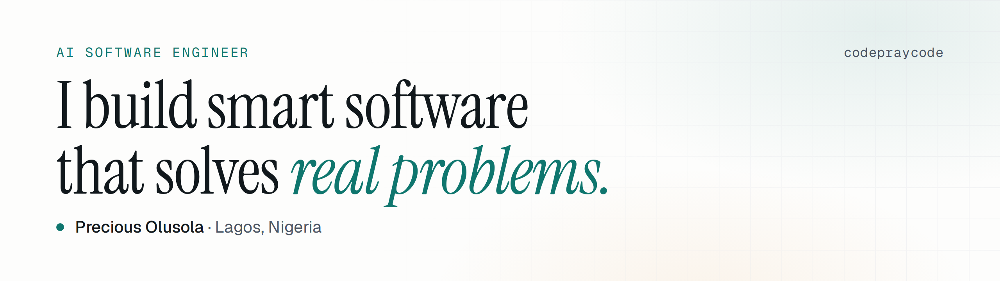

<a href="https://codepraycode.vercel.app">
  <picture>
    <source media="(prefers-color-scheme: dark)" srcset="assets/banner-dark.png" />
    
  </picture>
</a>

  
  
  
  

I build AI products end to end: the model, and everything around it that makes it dependable. I want to be able to take any idea and turn it into a working, intelligent product: on the web, on a phone, on a desktop, or on a piece of hardware. Everything below is the groundwork.

## Where I'm going

- **AI that holds up in production:** agents, retrieval and structured extraction, plus the evaluation work that shows whether an AI feature actually works.
- **Beyond the screen:** on-device models, embedded systems and hardware, so smart software can live where the problem is.
- **Products people use:** whatever the platform, real users and real problems solved.

I haven't built the thing that defines this yet. I'm building toward it in the open.

## What I've built

### [receipt-ocr-ng](https://www.npmjs.com/package/receipt-ocr-ng)

  

AI receipt reader for Nigerian fintech apps. Turns a photo of an OPay, PalmPay, Kuda, Moniepoint or bank receipt into structured JSON (amount, sender, recipient, reference, date, status) using a vision model on Groq. Published on npm. Demo: [dispacc-ocr.vercel.app](https://dispacc-ocr.vercel.app)

### Picsort

 

Sorts a large photo collection by the people in it, so everyone can find every photo they appear in. Face embeddings with InsightFace, HDBSCAN to group faces into people, and a FAISS index to find every photo of a person. Co-built.

### BCDees

 

Safer naira exchange for Nigerians in the diaspora. The naira is locked in escrow, the foreign currency moves outside the app, and the naira is released only when the user confirms it arrived. BCDees never holds foreign currency itself. Built on Node.js, Prisma and PostgreSQL, with BullMQ workers for transactions, KYC and reconciliation, real-time chat and dispute handling. Integrates Paystack and Veriff.

### Hivark

 

Rent-saving and property operations for Nigerian renters. Tenants save toward a yearly rent monthly, landlords get payouts, caretakers close maintenance jobs with photo proof. Hivark never holds funds itself. Expo / React Native app, plus an Express, Prisma, PostgreSQL and Redis API.

### [Movio](https://movioapp.vercel.app)

 

Smart campus transport for FUTA. Real-time GPS tracking and NFC tap-to-pay across the campus shuttle, keke and cab. Started as my final-year project, validated with a student survey and waitlist.

### [OracleSage](https://cf-ai-oraclesage.pages.dev)

 

AI Bible Q&A. Verse-grounded answers using Llama 3.3 on Workers AI, with conversation memory in KV.

### [RCF FUTA ICT](https://ict.rcffuta.com)

 

Digital systems for a 1,000+ member fellowship. As ICT coordinator I lead the fellowship's apps: member management, yearbook, library and internal email.

## How I work

- I find the root cause before I fix anything, and prove the fix with a test or a reproduction.
- I design for failure: retries, idempotency, graceful shutdown, and no surprises on money paths.
- I keep things simple and write down why decisions were made.

## Stack

  
   
  

**Also:** Expo / React Native and BullMQ. **AI:** LLM APIs (Groq, Cloudflare Workers AI), vision models, structured extraction, face embeddings and clustering. Learning Rust.

## Open to

Engineering roles and collaborations on products that solve real problems, especially where AI does the hard part. [Email me](mailto:preciousbusiness10@gmail.com).
